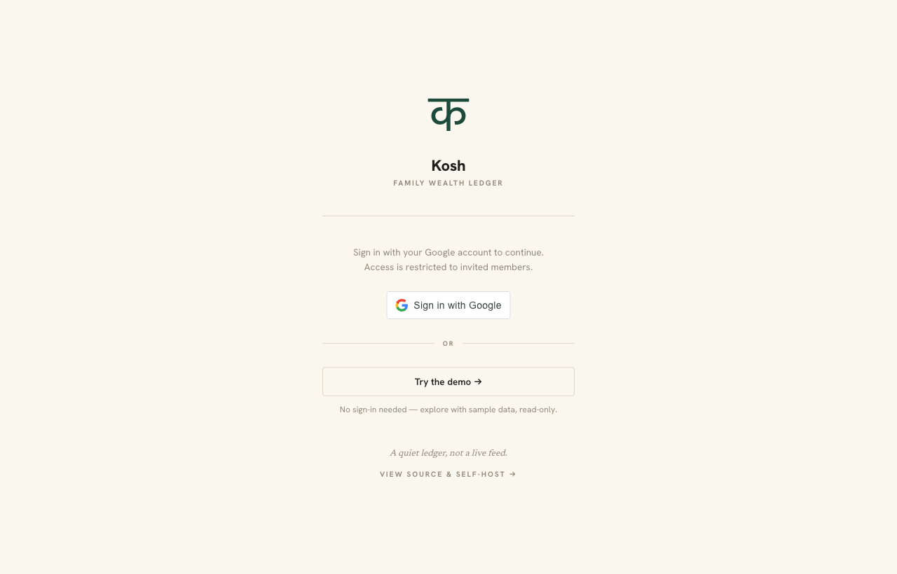
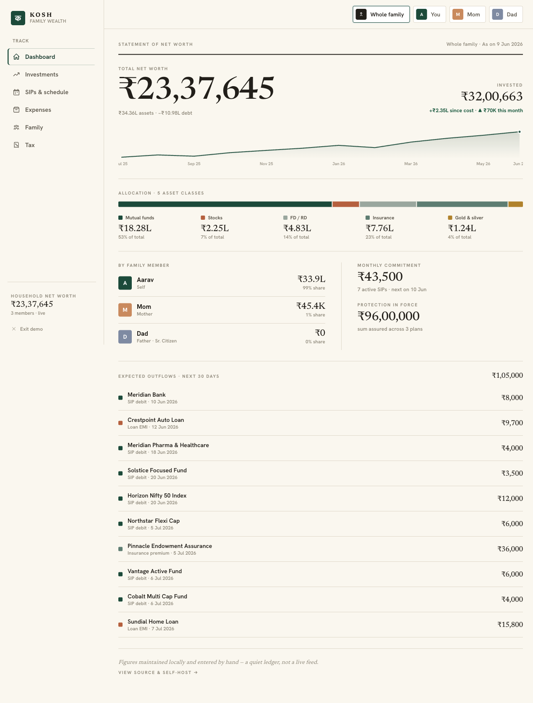
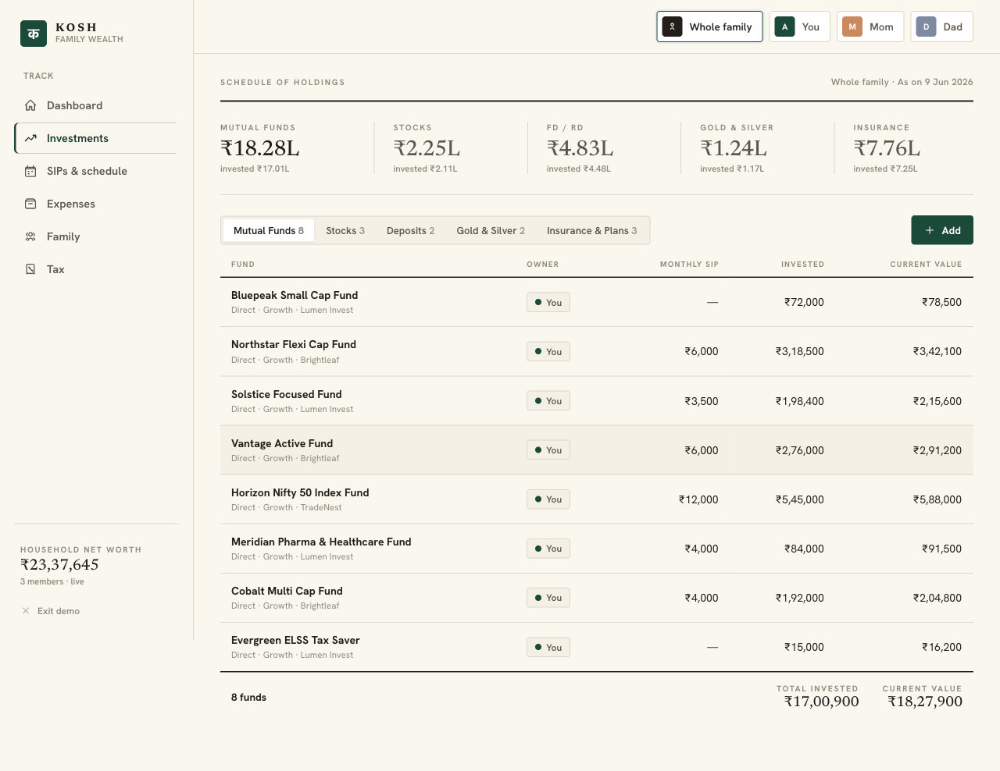
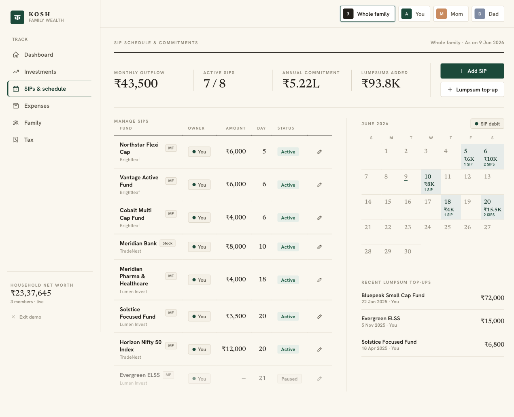
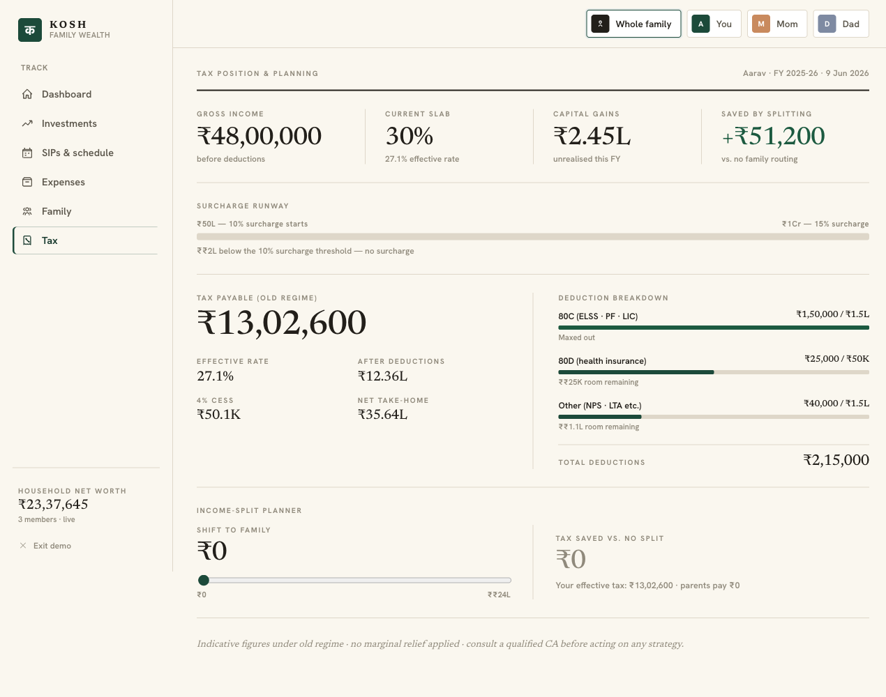
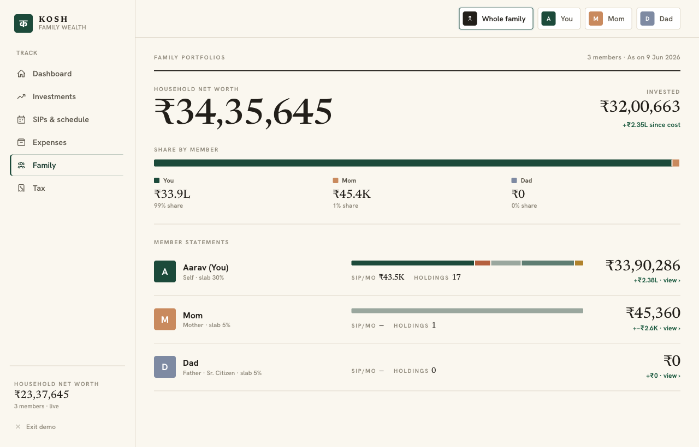

*Updated November 2026: hosting moved from Railway to Google Cloud Run, and a section on what's been built since launch.*

For the longest time, our family's finances lived across five apps, two spreadsheets, and a WhatsApp thread that somebody's dad keeps adding to. Mutual funds in one tab, FDs in another, insurance PDFs in a Drive folder, stocks inside a broker app, and gold was just… a number someone remembered.

I wanted one calm screen that answered *"where are we, financially, right now?"* for the whole household. So I built **Kosh** (कोश, Sanskrit for treasury).

## What I was solving for

- **Privacy.** Every wealth aggregator wants your bank login. Kosh has no sync, no scraping, no broker OAuth. You enter the numbers, and they live in a Google Sheet *you* own.
- **Spreadsheet fatigue.** A sheet works until you have eight members, twelve folios and a 2017 ULIP nobody understands. I wanted the control of a spreadsheet without maintaining formulas.
- **Families, not individuals.** My parents' FDs, my partner's SIPs and my stocks should roll up into one number, while each person can still be viewed on their own.

---

## A quick tour



There's a **Try the demo** button on the sign-in screen. It loads a realistic sample portfolio, with no login and no setup.

### Dashboard



Net worth, allocation by asset class, monthly SIP commitment, insurance cover, and a trend line. Chips at the top switch between the whole family and each member.

### Investments



Mutual funds, stocks, FDs and RDs, NPS, gold and silver, and insurance, each in its own tab. FD values are calculated from the rate and dates, and gold and silver follow the day's IBJA rate, so there's little to update by hand.

### SIPs and outflows



SIPs, loan EMIs and insurance premiums on one calendar, so nothing leaves your account by surprise.

### Tax: the screen I use most



Income, deductions (80C, 80D and others), this year's capital gains, and old vs new regime side by side, for every member. It now also suggests tax-saving moves and exports a report for your CA (more below).

### Family



Each member gets their own view, rolled up into the household total.

---

## What's new since launch

- **Ask Kosh:** an AI assistant that answers questions about your own portfolio.
- **AI tax planning:** tax-saving suggestions from your real numbers that follow up on last time's advice, an advance-tax schedule, and a one-click CA report (Excel or PDF).
- **Upload instead of type:** FD receipts, policies, payslips and NPS statements fill in their own fields.
- **NPS tracking** and **live gold and silver rates** from IBJA.
- **Needs attention:** flags matured FDs, premiums due soon, and deposits above the ₹5L insured limit at one bank, plus per-bank FD totals.
- **Income screen** for salary, freelance and rental income.
- **Family sharing:** a read-only report link, unlocked with an authenticator-app code.
- **PIN lock** and a proper **mobile layout**.

---

## The tech: deliberately boring

**Go** talks directly to the **Google Sheets API**: the sheet *is* the database, so there are no migrations and you can open, edit or export it any time. The frontend is **React + Vite** with a hand-rolled editorial look and no component library. Sign-in is Google, limited to emails you allow. AI features are optional (Anthropic or a local Ollama model). Licensed AGPL-3.0.

---

## Running it for free (or near free)

Kosh is one small Docker container on **Google Cloud Run**. It scales to zero when idle and wakes on the next visit, so a family tool opened a few times a day stays inside the always-free monthly allowance.

| Piece | What it's used for | Cost |
|---|---|---|
| Cloud Run | Runs the app | ₹0: free tier covers 2M requests, 180K vCPU-seconds and 360K GiB-seconds a month |
| Artifact Registry | Stores the Docker image | ₹0 under 0.5 GB (clear out old images now and then) |
| Google Sheets + Sign-In | Data and login | ₹0 |
| Anthropic AI (optional) | Tax suggestions, Ask Kosh, document reading | Pay-per-use, a few rupees a month at family usage; ₹0 if you skip it or use Ollama |

**Realistic total: ₹0 a month, or a few rupees if you turn on the AI features.**

Two caveats: Google Cloud needs a billing account linked even inside the free tier, and the first load after a quiet spell takes a second or two. A GitHub Actions workflow in the repo deploys on every push, and the same Dockerfile runs on a VPS or a Raspberry Pi too.

---

## Try it, then self-host

Click **Try the demo** on the sign-in screen. If it fits, [github.com/jenish-jain/kosh](https://github.com/jenish-jain/kosh) has the code; `docs/SELF_HOSTING.md` walks through connecting your sheet, sign-in and the Cloud Run deploy.

```bash
git clone https://github.com/jenish-jain/kosh
cd kosh
make install
make dev       # Go on :8080, Vite on :5173, sample data, no credentials needed
```

A hosted version is on the way for families who'd rather not run it themselves; your data would still live in a Google Sheet in your own Drive.

---

## Why open source

Every Indian family has some mix of mutual funds, FDs, insurance, gold and loans, and no clean way to see them together. If something's missing, open an issue or send a PR. Good first contributions:

- Import from a CAMS/KFintech CAS statement
- XIRR returns for each holding
- Better charts on the dashboard

The repo is at **[github.com/jenish-jain/kosh](https://github.com/jenish-jain/kosh)**. If you end up running it, I'd love to hear about it.
